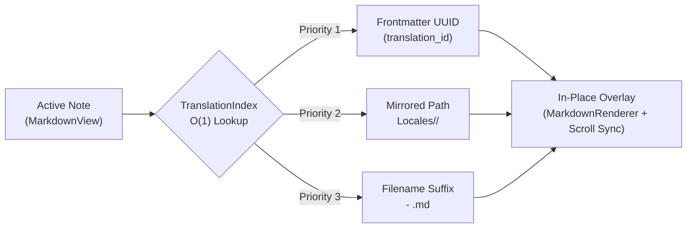

# Locale Mirror

An Obsidian plugin for rendering mirrored local note translations in place without duplicating files across the primary vault tree, search index, or graph view.

[](https://obsidian.md)
[](https://github.com/exekit-dev/Locale-Mirror/releases)
[](LICENSE)

---

## Overview

Maintaining multilingual notes or translated technical documentation inside an Obsidian vault typically creates two problems:

1. **Duplicate files in the main directory tree** pollute the File Explorer, Quick Switcher, Graph View, and full-text search results.
2. **On-the-fly machine translation plugins** require external API keys, network access, and recurring token costs, while frequently corrupting complex Markdown constructs such as callouts, code blocks, MathJax, and internal wikilinks.

**Locale Mirror** solves this by separating storage from presentation:

- Primary notes remain in their standard vault directories.
- Translated Markdown files are stored inside a dedicated root directory (`Locales/<LANG>/`) that mirrors the relative folder structure of the vault.
- Toggling a language renders the translated file directly inside the active note view (`MarkdownView`) using Obsidian's native `MarkdownRenderer`, while keeping the active file reference, backlinks, and relative asset paths anchored to the original note.

| Criterion | Duplicate Vault Folders | Live API Translation | Locale Mirror |
| :--- | :--- | :--- | :--- |
| File Explorer & Graph | Cluttered with duplicates | Unchanged | Clean (`Locales/` hidden & excluded) |
| Network / API Keys | Not required | Required | Not required (100% offline) |
| Markdown Fidelity | Native | Prone to formatting drift | Native (`MarkdownRenderer`) |
| Rename Resilience | Breaks manual links | N/A | Persistent via YAML `translation_id` |

---

## Core Capabilities

- **Non-Destructive In-Place Overlay**: Displays the translated document in both **Reading View** and **Live Preview** without modifying the underlying source file on disk or switching the active workspace tab.
- **Three-Tier Resolution Engine**: Resolves translations in $O(1)$ time via an in-memory index updated on vault and metadata cache events:
  1. **Frontmatter UUID (`translation_id`)**: Matches files sharing the same UUID value regardless of filename or directory changes.
  2. **Mirrored Relative Path**: Matches `Locales/<LANG>/<relative-path-to-note>.md`.
  3. **Filename Suffix Fallback**: Matches `<basename> - <lang>.md`, `<basename>.<lang>.md`, `<basename>_<lang>.md`, and `<basename> (<lang>).md` within the mirrored directory.
- **Default Display Language**: Optional vault-wide setting that automatically renders a specified language whenever a note with a matching translation is opened.
- **Asset & Link Inheritance**: Relative embeds (`![[diagram.png]]`) and internal links (`[[Note]]`, `[[#Heading]]`) inside a translation resolve against the original note's path first, eliminating the need to duplicate images or attachments inside `Locales/<LANG>/`.
- **Live Hot-Reload & Scroll Synchronization**: Relative scroll position is preserved when toggling between original and translated views. Saving changes to a translation file (e.g. in Split View or an external editor) immediately re-renders the active overlay in place.
- **Sidebar & Index Isolation**:
  - Dynamically hides the `Locales/` folder in Obsidian's File Explorer via CSS (configurable).
  - Provides a single-action toggle in Settings to register `^Locales/` in Obsidian's `userIgnoreFilters` (Excluded files).

---

## Directory Layout

Translations are organized by language code under the configured root directory (default: `Locales/`):

```text
VaultRoot/
├── Engineering/
│   ├── 01. System Architecture.md
│   └── assets/
│       └── topology.png
└── Locales/
    ├── DE/
    │   └── Engineering/
    │       └── 01. System Architecture.md
    ├── ES/
    │   └── Engineering/
    │       └── 01. System Architecture.md
    └── JA/
        └── Engineering/
            └── 01. System Architecture.md
```

Any first-level subdirectory inside `Locales/` (such as `DE`, `EN`, `ES`, `FR`, `JA`, `PT`) is automatically indexed as a language target.

---

## Resolution Architecture



### Persistent Pairing via Frontmatter UUID

To decouple translation pairing from filenames and directory paths, execute **`Locale Mirror: Assign / sync UUID to current note and its translations`** from the Command Palette (or enable **Assign shared UUID** when creating a new translation). Locale Mirror writes a shared RFC 4122 v4 UUID to the frontmatter of both files:

```yaml
---
title: System Architecture
translation_id: 7c9e6679-7425-40de-944b-e07fc1f90ae7
---
```

When `translation_id` is present, either file can be renamed or relocated within its respective tree without breaking resolution.

---

## Installation

### Method 1: BRAT

1. Install the [BRAT](https://github.com/TfTHacker/obsidian42-brat) plugin from Obsidian Community Plugins.
2. Open **Settings → BRAT → Add Beta plugin**.
3. Enter the repository URL:
   ```text
   https://github.com/exekit-dev/Locale-Mirror
   ```
4. Click **Add Plugin**, then enable **Locale Mirror** under **Settings → Community plugins**.

### Method 2: Manual Release Installation

1. Download `manifest.json`, `main.js`, and `styles.css` from the [latest GitHub Release](https://github.com/exekit-dev/Locale-Mirror/releases).
2. Place the files into your vault's plugin directory:
   ```text
   <VaultRoot>/.obsidian/plugins/locale-mirror/
   ├── main.js
   ├── manifest.json
   └── styles.css
   ```
3. Reload Obsidian (`Ctrl+R` / `Cmd+R`) and enable **Locale Mirror** under **Settings → Community plugins**.

---

## Commands

All commands are registered in the Obsidian Command Palette (`Ctrl+P` / `Cmd+P`) and can be bound to hotkeys:

| Command | Description |
| :--- | :--- |
| `Locale Mirror: Toggle translation` | Toggle between the original note and the preferred translation (or open the creation modal if no translation exists). |
| `Locale Mirror: Choose translation language for current note` | Select a specific display language or revert to `Original` for the active note. |
| `Locale Mirror: Set default display language` | Set a vault-wide default display language or switch back to manual toggling. |
| `Locale Mirror: Open translation for editing` | Open the matched translation file directly in an editor tab. |
| `Locale Mirror: Open translation in split view` | Display the original note and the editable translation file side by side. |
| `Locale Mirror: Create translation file (with shared UUID)` | Scaffold a mirrored translation file with optional content copy, shared UUID injection, and Split View opening. |
| `Locale Mirror: Assign / sync UUID to current note and its translations` | Generate and synchronize a shared `translation_id` UUID across the active note and all matched translations. |

---

## Configuration

| Option | Default | Description |
| :--- | :---: | :--- |
| **Translations root folder** | `Locales` | Vault-relative path containing per-language subdirectories. |
| **Default display language** | `Original` | Automatically render the selected language on note open when available. |
| **Hide translations folder in File Explorer** | `Enabled` | Hide the root translations directory in the File Explorer sidebar via dynamic CSS. |
| **Exclude translations from Search, Graph & Quick Switcher** | Action button | Register or remove `^<localesFolder>/` in Obsidian's `userIgnoreFilters`. |
| **Frontmatter UUID property** | `translation_id` | YAML property key inspected for Priority 1 UUID matching. |
| **Filename suffix fallback** | `Enabled` | Enable Priority 3 suffix matching (`Note - <lang>.md`, `Note.<lang>.md`, `Note_<lang>.md`, `Note (<lang>).md`). |
| **Show top banner on translated notes** | `Enabled` | Render the sticky control header inside active translation overlays. |
| **Show header button when no translation exists** | `Enabled` | Show a muted header action icon on untranslated notes to allow single-click translation creation. |
| **Show status bar indicator** | `Enabled` | Display the `ORIG` and language switcher controls in the bottom status bar. |
| **Sync scroll position when toggling** | `Enabled` | Preserve proportional vertical scroll position when switching views. |

---

## Documentation & Governance

- [Contributing Guidelines](CONTRIBUTING.md)
- [Security Policy](SECURITY.md)
- [Code of Conduct](CODE_OF_CONDUCT.md)
- [Changelog](CHANGELOG.md)

## License

Released under the [MIT License](LICENSE). Copyright (c) 2026 [Exekit](https://github.com/exekit-dev).
